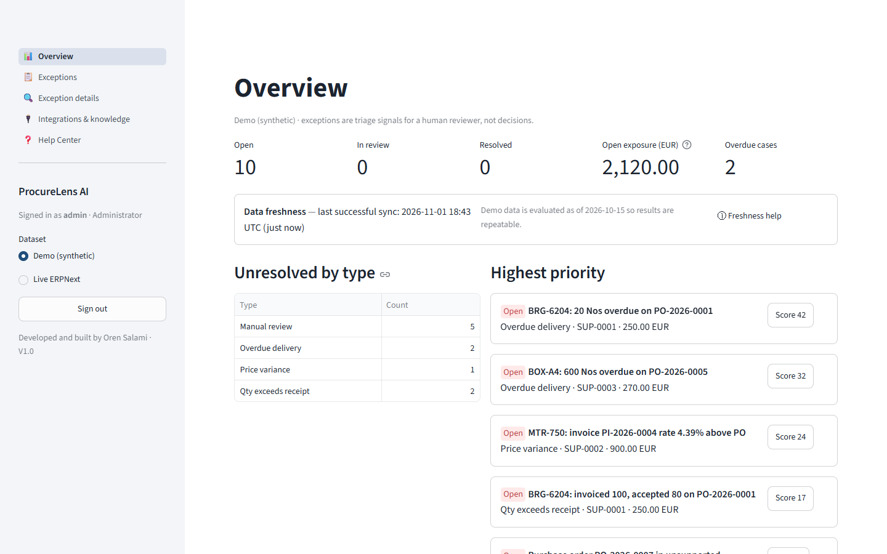
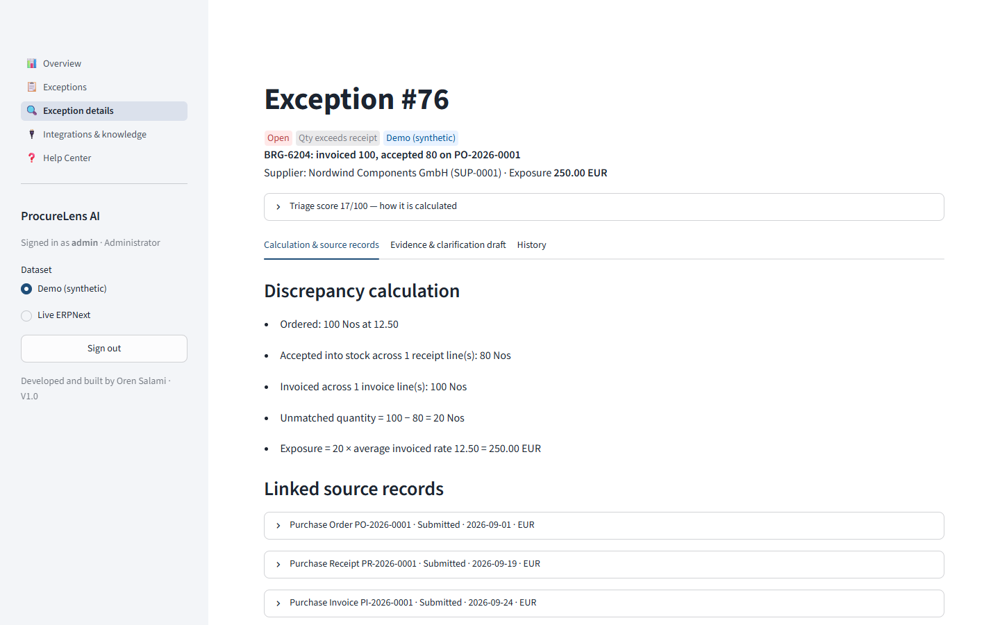
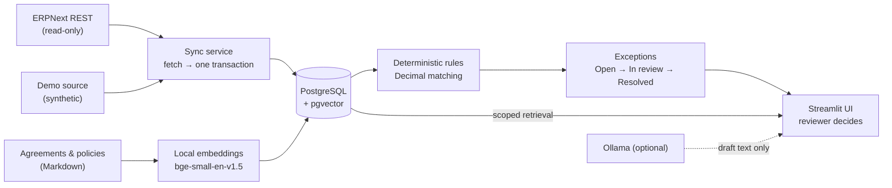
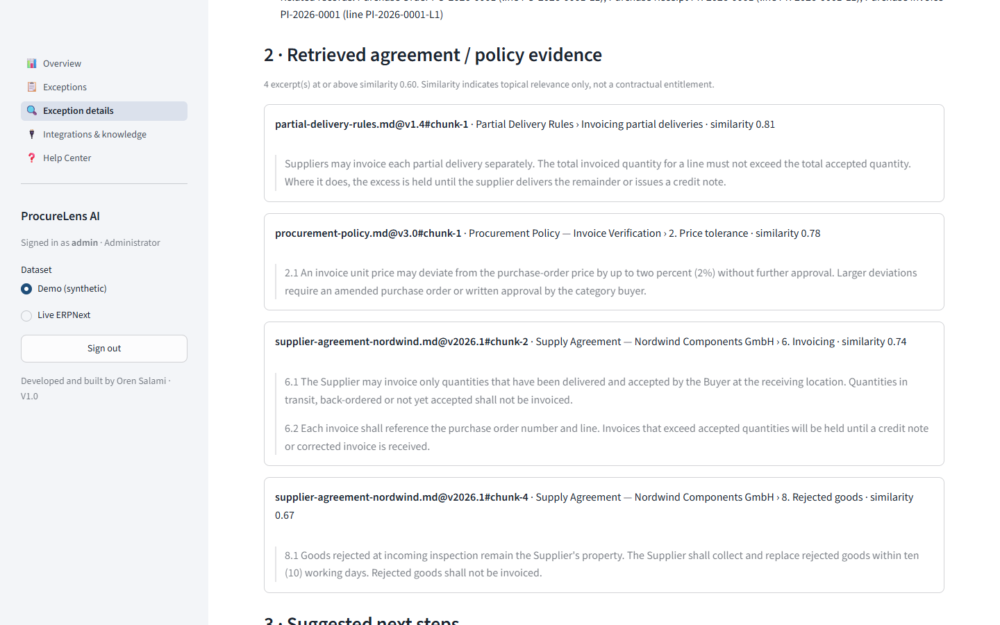
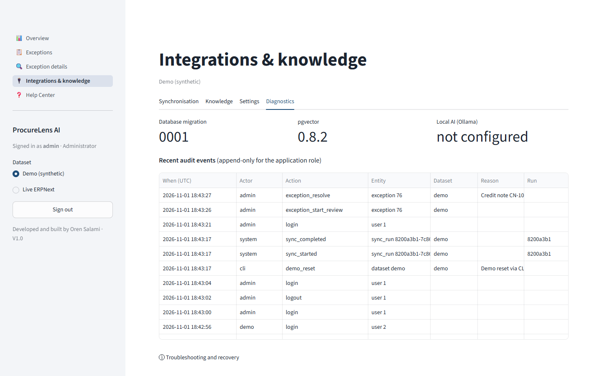

# ProcureLens AI

Procurement exception management for ERPNext: three-way matching of purchase orders, goods receipts and supplier invoices, with evidence and a human review workflow.

> **Status:** portfolio-ready engineering POC/MVP, **not** a production-certified financial system. Single currency, consistent units of measure. ERPNext adapter verified with HTTP contract tests only; it has not been tested against a live ERPNext instance.

## What it does

A purchase order asks for 100 units at an agreed price. 80 units are accepted into stock, but the supplier invoices 100. ProcureLens:

- finds the 20 unmatched units and calculates the exposure with exact decimals,
- shows the linked order, receipt and invoice lines (with the raw ERPNext snapshots),
- retrieves the relevant supplier-agreement and policy clauses, with file, version and section,
- prepares a clarification draft that a person reviews and sends,
- records the reviewer's decision, reason and evidence snapshot in an audit trail.

It detects **quantity** (invoiced > accepted), **price** (outside a configured tolerance) and **overdue delivery** discrepancies. Records it can't calculate safely, such as foreign currency, unit conversions, returns or missing references, are flagged for **manual review** instead of being guessed. It never pays, posts, writes to ERPNext or contacts suppliers.



## Why it matters

Invoice discrepancies are usually found late and investigated by hand across several ERP screens and contract PDFs. ProcureLens puts the calculation, the source records and the relevant contract text on one page. Decisions stay with people: amounts, matching and statuses come only from deterministic rules. Semantic search and the optional language model only supply context.



## How it works



The app is a modular Python monolith: a pure `domain` layer (rules, scoring, lifecycle), `services` (authorization, transactions, audit), `adapters` (ERPNext, PostgreSQL, embeddings, Ollama) and a thin Streamlit `ui`. See [ARCHITECTURE.md](docs/ARCHITECTURE.md).



## How to run it

Requirements: Docker with Compose v2, Bash (Git Bash on Windows) and ~2 GB of disk. The first build downloads Python packages and the embedding model (~67 MB) from the internet. After that, the default stack runs without network access or paid services.

```bash
./scripts/init-env.sh          # creates .env with random DB secrets + private dir (~/.procurelens/private)
./scripts/check-port.sh        # the UI needs 127.0.0.1:8089; reports a conflict instead of changing ports
docker compose up -d --build   # app + PostgreSQL/pgvector; a one-shot `init` runs migrations and bootstrap
```

Open **http://localhost:8089**.

**First sign-in.** On the first start, `init` generates strong passwords for the administrator (`admin`) and a read-only demo account (`demo`). It writes them only to `procurelens-credentials.txt` in your private directory (`PROCURELENS_PRIVATE_DIR` in `.env`), with owner-only permissions. Passwords are never logged. Later restarts keep existing data and never recreate credentials or reseed demo data. To reset a password:

```bash
docker compose run --rm init python -m procurelens.cli reset-password --user admin
```

On networks that inspect TLS, pass a CA bundle to the build only: `BUILD_CA_FILE=/path/ca.pem ./scripts/start.sh` (it is mounted as a build secret and not stored in the image).

**Optional local AI.** Set `OLLAMA_BASE_URL=http://ollama:11434` in `.env`, then run:

```bash
docker compose --profile ai up -d
docker compose exec ollama ollama pull qwen2.5:3b    # one-time ~1.9 GB download
```

Without it, the app uses deterministic templates. See [OPERATIONS.md](docs/OPERATIONS.md) for backup/restore, ERPNext setup, demo reset and troubleshooting.



## Verified in this release

- 121 automated tests: domain rules, ERPNext HTTP contract tests, authorization, sessions, and PostgreSQL/pgvector integration on a real database, plus a retrieval evaluation (recall@3 = 1.0 on 10 questions; all 5 off-topic questions correctly reported as insufficient evidence).
- 12/12 browser checks against the running Compose stack: sign-in, demo read-only, investigation, evidence, resolution, audit, logout and session isolation.
- Data persistence across `docker compose down`/`up`. Backup restored into an isolated database with identical row counts.
- Optional Ollama (`qwen2.5:3b`, CPU) generated validated drafts in ~80–110 s; its fallback was verified.
- Terraform for an optional single-host AWS demo passes `fmt` and `validate`. It has **not** been applied.

Details and known limitations: [TESTING_AND_LIMITATIONS.md](docs/TESTING_AND_LIMITATIONS.md) · Security and governance: [SECURITY_AND_GOVERNANCE.md](docs/SECURITY_AND_GOVERNANCE.md) · AWS: [infra/terraform/aws](infra/terraform/aws/README.md)

---

Developed and built by Oren Salami · V1.0
